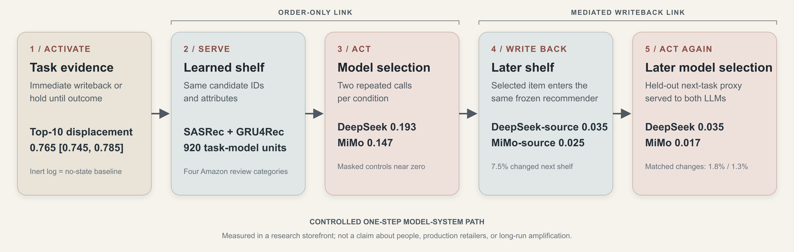

# The Agent Became Me

Two AI shopping agents, 920 shelves, and the profile a shop keeps about you.



I let an AI shop for me for a few months. Before long the recommendations were full of things I did not recognise. This repository is the study I built to find out how that happens, and the design I made in response.

The study treats two language models as the users. DeepSeek V4 Flash and MiMo V2.5 shopped 460 tasks in a research storefront whose shelves come from two learned recommenders (SASRec and GRU4Rec) trained on four Amazon Reviews 2018 categories. Changing nothing but the order of a shelf changed what the agent picked on 88 of 920 shelves for one model and 68 of 920 for the other. Those picks were written back into the profile, moved the next shelf, and changed the next choice. Almost every swap was a toss-up: of the 462 shelves with an eligible product, 452 had more than one equally good one. The agent did its task, the task left a tie, and the shelf order broke it.

The research was published as a poster at HAI ’26 and is sole-authored. Clean Record is the service design that follows from it.

## The paper

Kaiqi Feng. 2026. **From Shelf Order to Later Agent Choice: A Link-by-Link Audit of Recommendation Writeback.** In *Proceedings of the 14th International Conference on Human-Agent Interaction (HAI ’26)*, November 16–19, 2026, Osaka, Japan. ACM, 3 pages. Poster. https://doi.org/10.1145/3841580.3845761

- The accepted camera-ready: [`paper/HAI2026_From_Shelf_Order_to_Later_Agent_Choice_poster.pdf`](paper/HAI2026_From_Shelf_Order_to_Later_Agent_Choice_poster.pdf) (CC BY 4.0)
- LaTeX source, Figure 1 as PDF and SVG, and the S1 prompt record: [`experiments/hai-2026-camera-ready/`](experiments/hai-2026-camera-ready/)
- The project page with the explainer film: https://troyfeng-designintelligence.github.io/work/the-agent-became-me/

## What the paper measured

Five links, each with its own control. Distances are categorical energy distances between paired conditions; brackets are 95% intervals.

| Link | What changed | Result |
| --- | --- | --- |
| 1 Activate | Write task evidence back immediately, or hold it until the task ends | In-task Top-10 displacement 0.765 [0.745, 0.785]. After the outcome, and at the next task, 0.000. Logging without activation did nothing. |
| 2 Serve | 460 tasks × 2 recommenders | 920 task-model units |
| 3 Act | Same candidates, different order | DeepSeek 0.193 [0.151, 0.239] against a masked control of 0.004 [−0.003, 0.013]; MiMo 0.147 [0.110, 0.187] against 0.000 [−0.007, 0.008] |
| 4 Write back | The order-induced pick goes into the profile | Next shelf 0.035 [0.024, 0.047] (DeepSeek-sourced) and 0.025 [0.016, 0.035] (MiMo-sourced); 7.5% of later shelves changed |
| 5 Act again | The changed shelf is served to the same agent | Later choice 0.035 [0.017, 0.054] and 0.017 [0.005, 0.032]; paired repeats changed in 1.8% (34 of 1,840) and 1.3% (24 of 1,840) of cases; two 226-unit byte-identical controls: 0 |

In this research storefront, order-induced choices changed later learned-recommender exposure and a second categorical agent choice, establishing a measurable one-step model–recommender feedback path. It does not establish long-run amplification, harm, or anything about a real shop.

Scale: 7,360 of 7,360 confirmatory calls valid, 9,168 calls on the feedback endpoints plus byte-identical controls, temperature 0, August 2026.

## What I tried after the paper

Between September and October 2026 I ran six more experiments on the same 920 shelves. Each protocol was frozen (SHA-256 in `protocol.json`) and its decision rule written down before the first call. None of this is in the paper.

| Experiment | Folder | What happened |
| --- | --- | --- |
| Tell the agent the shelf was ordered by the recommender | `experiments/order-notice/` | No detectable effect on swaps for either model. The order effect was still there: 45 and 71 swaps against noise floors of 5 and 3. |
| Write a tie rule into the task | `experiments/tie-rule/` | Cut order-driven swaps by about 40% for MiMo (70 → 43) and did nothing detectable for DeepSeek. Asked to report the tie, MiMo did so almost perfectly; DeepSeek did so on 41% of calls and was right whenever it did. |
| Ask the agent to check every product first | `experiments/check-first/` | Did not reduce the errors the order caused. MiMo’s swaps fell by about 30%; both models abandoned more tasks. |
| State three fit facts on the shelf | `experiments/vote-facts/` | Order-caused wrong picks fell from 41 to 2 (DeepSeek) and 66 to 7 (MiMo). The first design that moved DeepSeek: it ignored added instructions and used added facts. The facts were computed from the same words that score the task, so this is an upper bound. |
| Re-ask once in a random order before writing back | `experiments/vote-facts/` | Kept 75% (DeepSeek) and 56% (MiMo) of wrong picks out of the record, but held about half of the right ones. Nearly all of those were ties the order had broken. Costly, by the rule set in advance. |
| Shelf facts and the random re-ask together | `experiments/shelf-door/` | Wrong picks reaching the record fell from 55 to 4 and from 144 to 12; order-decided picks fell by 61–77%. Still costly: about half of the stable right picks were held back. |

Same requests, seven weeks later: 21% of DeepSeek’s answers changed and its order effect halved (88 → 45). MiMo, still reporting the same model, changed 5% and kept its effect (68 → 71). The published 88 of 920 is an August number for a model that has since changed.

`experiments/agent-interviews/` holds a probe that interviewed both models about their own shopping (12 sessions, 14 questions, a card sort of nine kinds of evidence, and a co-design round). Asked about a product that was never on the shelf, all 12 sessions declined to invent a reason. Every one of the 12 co-design proposals removed the agent’s confidence score. The answers are generated text, not the models’ inner view.

## Clean Record


Clean Record is the profile I designed for this situation: a service blueprint and three interface changes, so that what the record keeps still looks like the person.

- A rules page that says what the agent may write back and what expires with the task.
- Fact labels on the shelf, so the agent can act on facts instead of position.
- A review step before anything is written into the profile.

The last experiment above is the test of the last two changes. By my own rule the review step was costly: it held back about half of the right picks, nearly all of them ties. The design is a response to the finding, not a deployed policy. The 3D model, the service blueprint and the explainer film are on the project page.

## Run it

Requires Node.js 24 and pnpm 11.9.0.

```bash
pnpm install --frozen-lockfile
pnpm dev
```

`http://127.0.0.1:5173/` opens the narrative site. `http://127.0.0.1:5173/?view=storefront&task=cereal-selected&arm=held` opens the research storefront: a static web application with no account, cart, checkout or payment, see [`docs/ONLINE_STOREFRONT.md`](docs/ONLINE_STOREFRONT.md). `pnpm check` runs the typecheck, the tests, the artifact verifier and the evaluators, then builds.

The published studies read from `public/results/` and from each experiment’s `results/summary.json`; the evaluators in `scripts/` recompute them. Re-running the model calls needs DeepSeek and MiMo API keys in `.env` files that are not in the repository.

## Repository map

- `src/` the site and the deterministic simulator, React and TypeScript
- `experiments/online-storefront-v2` to `v10` the storefront studies that led to the paper, including the invalidated v5 and the repaired v6
- `experiments/hai-2026-camera-ready/` the paper source, Figure 1 and the S1 prompt record; `experiments/hai-2026-poster/` the submission
- `experiments/order-notice/`, `tie-rule/`, `check-first/`, `vote-facts/`, `shelf-door/`, `agent-interviews/` the post-study experiments, each with `PROTOCOL.md`, `protocol.json` and `results/`
- `public/results/` pseudonymous rows, summaries and integrity hashes for every published study
- `docs/` [claim boundaries](docs/CLAIM_BOUNDARIES.md), [protocol](docs/PROTOCOL.md), [trace schema](docs/TRACE_SCHEMA.md), [data and reuse](docs/DATA_AND_REUSE.md), [AI use](docs/AI_USE.md) and the [earlier testbed](docs/EARLIER_TESTBED.md)
- `paper/` the accepted poster

## Boundaries

- There were no human participants. The two users are language models, and their interview and co-design answers are generated text.
- Everything was measured in a research storefront with its own recommenders. It shows nothing about what any real shop does.
- The order effect sits inside ties that the task’s coarse scoring left open. Real product data would have more missing and wrong facts, not fewer.
- Nothing here measures trust, satisfaction, identity or consent.
- Clean Record was tested by a rule fixed in advance, and that rule judged the review step costly.
- The illustrations on the project page were generated with ChatGPT around a character I designed. They are decorative, not evidence. The full list is in [`docs/AI_USE.md`](docs/AI_USE.md).

## The earlier testbed

Before the storefront studies, the project was a synthetic agent–computer-interaction testbed that compared six profile-update contracts. Its most useful result was a failed strong claim: a provenance-aware updater lost to a non-selective shrinkage control in all 12 scenario cells and 456 of 480 paired runs, so attenuation, not provenance, explained the improvement. That record, with the WebArena trace check, the signed-out Amazon probe, the MovieLens and SASRec validations and the storefront pilots, is kept unchanged in [`docs/EARLIER_TESTBED.md`](docs/EARLIER_TESTBED.md).

## AI use

Parts of the code, for the testbed and the experiments, were written with AI coding assistants, and AI assisted the data analysis. The two language models in the study are its subjects, not its authors. Illustrations: ChatGPT, character by the author.

## Author and licence

Kaiqi Feng, College of Design and Innovation, Tongji University. Research, experiments, analysis, interaction design, 3D model and visuals by the author.

Code and documentation are under the [MIT License](LICENSE). Data artefacts have their own terms, see [`DATA_LICENSE.md`](DATA_LICENSE.md); the Amazon Reviews 2018 and MovieLens inputs are not redistributed. The paper is CC BY 4.0.

If you use this work, cite the paper above.
