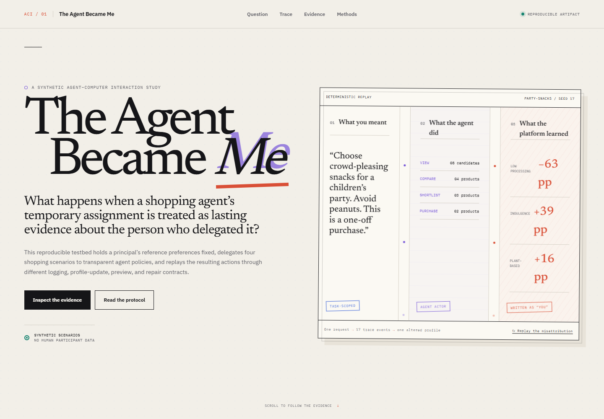

# The Agent Became Me

> You asked it to shop. The system watched.



**The Agent Became Me** is an interactive Agent–Computer Interaction (ACI)
testbed about delegated action and persistent personalization. It asks a narrow
question: when a shopping agent explores products for a temporary task, which
of its actions should become long-term evidence about the human principal?

The repository combines:

- a static React portfolio experience;
- a deterministic TypeScript simulation;
- two separated synthetic experiments;
- versioned product metadata and generated results;
- inspectable behavior traces and profile-update receipts.

No API key is required. There are no human participants, real user profiles, or
LLM-generated evaluation scores in the registered baseline.

## Claim boundary

The title is deliberately provocative. The implementation measures changes to a
**simulated inferred preference profile**, not a person's identity or inner
state.

Results in this repository describe this synthetic testbed under its registered
rules. They do not establish:

- how a commercial platform currently updates profiles;
- how people experience delegation, consent, trust, or control;
- that a synthetic preference vector represents a complete person;
- that the tested mechanisms are universally preferable.

See [Claim Boundaries](docs/CLAIM_BOUNDARIES.md) and the
[Experimental Protocol](docs/PROTOCOL.md) before quoting a result.

## Research design

The project separates two causal questions.

### Study A — Trace attribution

A behavior trace is generated once and then replayed under four profile-update
contracts:

| Condition | Operational difference |
| --- | --- |
| Actor-blind | Treats agent activity as principal activity |
| Logged-only | Records provenance but does not use it |
| Provenance-aware | Downweights non-commit agent activity |
| Approval-gated | Learns only within the registered approval scope |

Holding the behavior trace fixed isolates how the simulated platform interprets
the same actions.

### Study B — Agent-facing affordances

The profile updater is held constant while the agent receives one of three
interfaces:

| Condition | Available capability |
| --- | --- |
| Action-only | View, compare, shortlist, and purchase |
| Impact preview | Adds projected profile impact |
| Preview and repair | Adds temporary evidence and repair behavior |

Study B may change the behavior trace. Its results therefore cannot be used to
attribute an effect to logging alone.

## Committed evidence

The current `protocol.v1` output contains:

- 90 public product-metadata records;
- 4 deliberately constructed synthetic scenarios;
- 3 transparent agent policies;
- 40 paired seeds per baseline cell;
- 1,920 Study A rows;
- 1,440 Study B rows;
- 9,600 sensitivity-analysis rows.

The three registered outcomes are:

1. future recommendation regret;
2. profile contamination;
3. current task utility.

A deterministic evaluator computes all three. The repository also reports
attribution error, interaction cost, and hard-constraint violations as
diagnostics.

### Baseline snapshot

These are generated means from `protocol.v1`, not estimates of real-world
platform or human behavior.

| Study A contract | Runs | Profile contamination | Future regret | Task utility |
| --- | ---: | ---: | ---: | ---: |
| Actor-blind | 480 | 0.311 | 0.035 | 0.434 |
| Logged-only | 480 | 0.311 | 0.035 | 0.434 |
| Provenance-aware | 480 | 0.187 | 0.006 | 0.434 |
| Approval-gated | 480 | 0.016 | 0.000 | 0.434 |

The actor-blind and logged-only results are identical by design: provenance is
present in the latter audit trail but unavailable to the updater. Study A
freezes behavior, so task utility is also identical across contracts.

| Study B interface | Runs | Profile contamination | Future regret | Task utility | Modeled cost |
| --- | ---: | ---: | ---: | ---: | ---: |
| Action-only | 480 | 0.187 | 0.006 | 0.434 | 0 |
| Impact preview | 480 | 0.180 | 0.006 | 0.432 | 3 |
| Preview and repair | 480 | 0.131 | 0.004 | 0.432 | 8 |

Study B permits the interface to alter the trace. Its cost values are simulator
units, not human time or cognitive load.

## Local development

### Requirements

- Node.js 24
- pnpm 11.9.0

Install dependencies from the committed lockfile:

```bash
pnpm install --frozen-lockfile
```

Start the local development server:

```bash
pnpm dev
```

Vite prints the local URL, normally `http://localhost:5173`.

Build and preview the production bundle:

```bash
pnpm build
pnpm exec vite preview
```

## Verify the repository

Run the complete local gate:

```bash
pnpm check
```

This runs TypeScript checking, the Vitest suite, and the production build. The
individual commands are:

```bash
pnpm typecheck
pnpm test
pnpm build
```

With the development server running on port `4173`, the repository also
contains an interaction, console-error, reduced-motion, and responsive-overflow
browser check:

```bash
pnpm dev --host 127.0.0.1 --port 4173
pnpm qa:site
```

Set `PLAYWRIGHT_CHANNEL` if the default `msedge` channel is unavailable.

## Reproduce the generated results

The committed Open Food Facts snapshot is the input to the registered baseline.
Regenerate the full and aggregated outputs with:

```bash
pnpm experiment
```

This overwrites:

```text
public/results/v1/baseline.json
public/results/v1/summary.json
```

For fixed source code, catalog snapshot, Node version, and seed configuration,
the simulated rows and metrics are deterministic. The `generatedAt` timestamp is
expected to change, so the JSON files are not byte-identical across runs.

To inspect changes:

```bash
git diff -- public/results/v1/
```

### Refreshing the external catalog

Refreshing the Open Food Facts input is a separate, networked operation:

```bash
pnpm data:fetch
pnpm experiment
```

`pnpm data:fetch` overwrites the committed catalog snapshot. Open Food Facts is
a changing external database, so a refreshed snapshot is a new dataset—not a
reproduction of the committed one. Review its diff and attribution before
committing it.

## Repository map

```text
src/domain/             Runtime schemas and TypeScript types
src/sim/                Named random streams, scenarios, and behavior traces
src/recommender/        Ranking and profile-update contracts
src/experiments/        Replay, metrics, and experiment runner
src/components/         Interactive trace and editorial evidence components
src/visualizations/     Accessible React/D3 analytical figures
scripts/                Catalog refresh and baseline generation
public/data/            Versioned product-metadata snapshot
public/results/v1/      Full rows, aggregates, and representative replay
tests/                  Determinism and mechanism checks
docs/                   Protocol, claims, trace, reuse, and AI-use records
```

For trace semantics, see [Trace Schema](docs/TRACE_SCHEMA.md). For the visual
evidence plan, see [Analytical Chart Map](docs/CHART_MAP.md).

## Data, reuse, and attribution

The committed product snapshot contains information from
[Open Food Facts](https://world.openfoodfacts.org/), made available under the
[Open Database License 1.0](https://opendatacommons.org/licenses/odbl/1-0/).
ODbL attribution and share-alike terms apply to that database material and
derived database outputs.

The project excludes product images, reviews, accounts, and user-level records.
All principals, delegation briefs, action traces, and outcomes are synthetic.

The trace vocabulary is informed by
[W3C PROV-O](https://www.w3.org/TR/prov-o/) and the
[W3C Data Privacy Vocabulary](https://www.w3.org/community/dpvcg/wiki/Main_Page).
This project does not claim full conformance with either standard.

The architecture was informed by public recommender-simulation work including
RecSim and T-RECS, but it embeds neither framework. Full reuse notes and source
links are in [Data and Reuse](docs/DATA_AND_REUSE.md).

IBM Plex and Newsreader are bundled locally through Fontsource under the SIL
Open Font License 1.1. Runtime libraries retain their respective upstream
licenses.

## AI use

AI-assisted development is disclosed in [AI Use](docs/AI_USE.md). Generative AI
is not part of the default runtime, policy logic, metrics, or registered
evaluation. The committed experiment can be built and reproduced without an
external model service.

## GitHub Pages

The workflow at `.github/workflows/pages.yml` verifies and deploys the static
Vite build.

1. In the GitHub repository, open **Settings → Pages**.
2. Set **Source** to **GitHub Actions**.
3. Push to `main`, or run **Deploy static site to Pages** manually from the
   Actions tab.

The workflow installs the locked dependencies, runs `pnpm check`, uploads
`dist/`, and deploys it to the `github-pages` environment. It requires no
repository secrets or API keys.

If the repository uses a default branch other than `main`, update the branch in
`.github/workflows/pages.yml`.

## License

Project code and original documentation are released under the
[MIT License](LICENSE). The Open Food Facts snapshot and database-derived
material remain subject to ODbL 1.0; the MIT license does not replace those data
terms.
